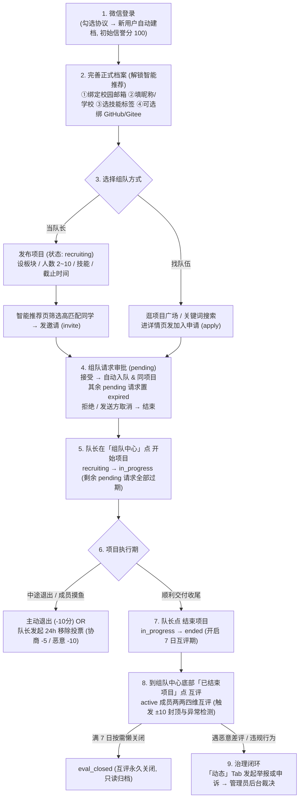
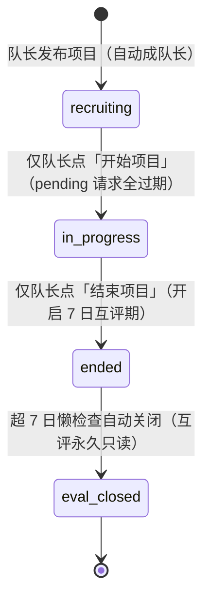
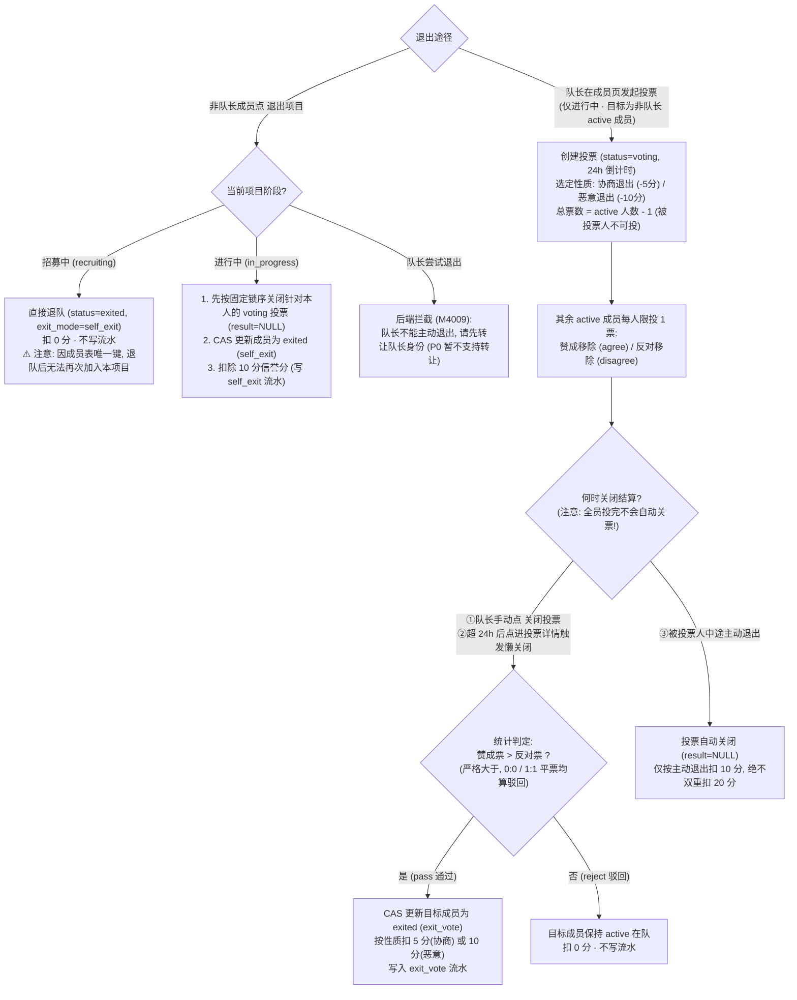
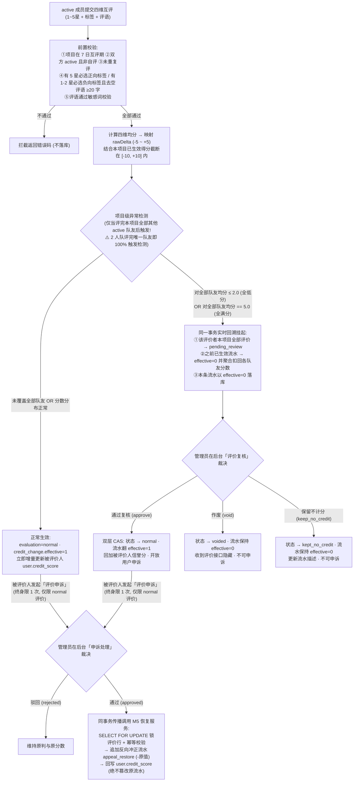
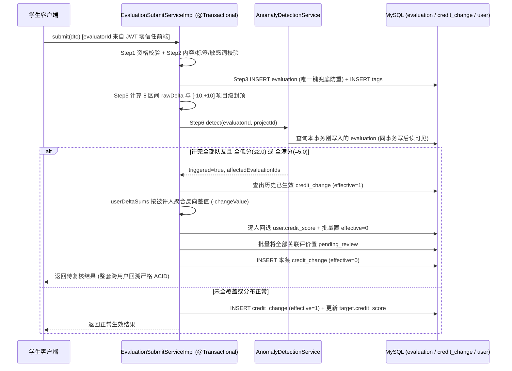
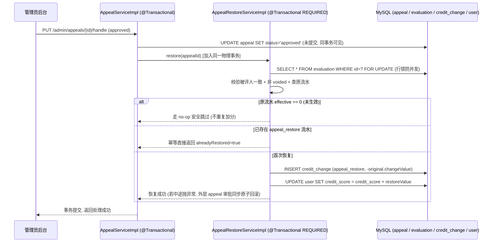

# TeamMatch 校园组队与互评平台 —— 用户、管理员与核心架构完整手册

> **对应仓库**：后端 [`GYC-Debug-create/teammatch-backend`](https://github.com/GYC-Debug-create/teammatch-backend) ｜ 前端 [`GYC-Debug-create/teammatch-frontend`](https://github.com/GYC-Debug-create/teammatch-frontend)  
> **适用对象**：高校学生用户（微信小程序端）、平台管理员（Web 管理后台），以及关注底层账本、状态机与并发治理的技术评审者  
> **文档定位**：本手册依据 **ISO/IEC/IEEE 26514** 与 **GB/T 8567-2006（软件用户手册）** 规范编写，经**双轮独立对抗式源码交叉审查**（逐行核对前后端 Java / MySQL Schema / 小程序 33 页 / 管理后台 8 页与 4,200+ 行测试代码），确保每一个按钮行为、规则边界、已知前后端对齐现状与 **M5 深度参与模块的技术深度** 100% 真实可核验。本地启动与环境变量配置请参阅各仓库 `README.md`。

---

## 目录

1. [平台简介、双端角色与鉴权基线](#一平台简介双端角色与鉴权基线)
2. [核心业务流程与四大状态机全景图](#二核心业务流程与四大状态机全景图)
3. [学生用户操作手册（微信小程序 33 页全按钮后果表）](#三学生用户操作手册微信小程序-33-页全按钮后果表)
4. [管理员操作手册（Web 管理后台 8 路由全操作后果表）](#四管理员操作手册web-管理后台-8-路由全操作后果表)
5. [平台核心规则速查与端到端账本数值推演](#五平台核心规则速查与端到端账本数值推演)
6. [核心技术深度解析（深度参与模块：M5 互评、信誉账本与并发治理架构）](#六核心技术深度解析深度参与模块m5-互评信誉账本与并发治理架构)
7. [高频错误码排障表、公开版本已知限制与 FAQ](#七高频错误码排障表公开版本已知限制与-faq)

---

## 一、平台简介、双端角色与鉴权基线

**TeamMatch（中文品牌名：汇行录）** 是一款面向高校学科竞赛、大创与课程项目的**“组队招募 + 过程退出仲裁 + 结项四维互评 + 可追溯信誉账本 + 平台治理”**全栈平台，涵盖：

| 使用端 | 面向角色 | 规模与入口 | 核心职责 |
| :--- | :--- | :--- | :--- |
| **微信小程序端** | 学生用户（普通成员 / 队长） | 底部 4 个 TabBar（首页 / 组队 / 动态 / 我的），共注册 **33 个页面** | 微信一键登录、校园邮箱与档案建档、GitHub/Gitee 技术画像、项目发布与智能推荐邀人、组队审批、阶段推进、退出与 24h 投票仲裁、结项互评、信誉流水、举报与申诉 |
| **Web 管理后台** | 平台管理员（`role=admin`） | Vue 3 + Element Plus 后台，共 **8 个路由页面** | 板块增删改与所属项目查看、举报工单处置、申诉审批（同事务联动信誉冲正/自动撤罚）、异常评价复核、扣分/封禁处罚执行与撤销 |

- **认证与安全基线（源码实证）**：
  - 微信登录新用户自动建档（默认昵称 `User_{openid前8位}`，初始信誉分 **`100`**，角色 `user`，状态 `active`）；管理员仅支持预置账号密码登录（非 `admin` 角色返 `M3009`）。
  - 后端统一签发 **7 天有效期 JWT**（普通用户与管理员一致，无 refresh token）；封禁账号（`status != 'active'`）在**登录接口**触发 `M3017` 阻断，已持有效 Token 的在线会话不会在中途即时失效。
  - **正式档案完成条件**：`邮箱已认证` + `昵称非空` + `学校非空`（三者齐备自动置 `formal_profile_completed = true`，解锁智能推荐召回资格）。

---

## 二、核心业务流程与四大状态机全景图

### 2.1 学生用户完整生命周期流程图



### 2.2 项目生命周期（4 态单向不可逆）与组队请求（5 态）

> **冻结基线**：项目状态严格单向流转，P0 **不支持项目删除/解散、软删除或队长转让**。



- **组队请求（`invite` 邀请 / `apply` 申请）核心约束**：
  - 发起：项目须 `recruiting`、当前 `active` 人数 `< max_members`、目标未在队，且同一 `(项目, 双方)` 无论方向或类型**绝不允许并存两条 `pending` 请求**（DB 条件唯一键兜底）。
  - 流转：`pending` → `accepted`（邀请由被邀人点、申请由队长点；入队同事务将此人在本项目的其他 `pending` 请求批量置 `expired`）/ `rejected` / `cancelled`（仅发送方本人可取消）/ `expired`。

### 2.3 执行期退出与 24 小时投票移除全分支图



### 2.4 M5 互评、异常检测挂起、复核与申诉恢复全链路图



---

## 三、学生用户操作手册（微信小程序 33 页全按钮后果表）

### 3.1 登录、协议、邮箱认证与档案建设（9 页）

| 页面 | 全部核心控件与按钮 | 精确规则、字数上限与点击后果 |
| :--- | :--- | :--- |
| **登录页** (`login`) | `立即体验` / 协议勾选框 / 《用户协议》/《隐私政策》 | 须先勾选协议（未勾选会抖动提示）；点击走微信登录（拒绝授权昵称头像仍可登录），成功进首页。点两份协议进只读页，底部「已知晓」返回。*（账号被封禁时接口返 `M3017` 阻断登录。）* |
| **校园邮箱认证** (`email-verify`) | `发送验证码` / `验证邮箱` / `换绑邮箱` / `确认换绑` / `取消换绑` | 小程序前端要求 `.edu.cn` 结尾且 ≤ 30 字（后端校验通用邮箱正则）；发送后 60 秒冷却，验证码 6 位 10 分钟有效。首次认证成功自动返回上一页并重算「正式档案」；换绑成功留在已认证态；已被他人绑定报 `M3002`，重复验证自己当前邮箱报 `M3028`。 |
| **微信信息授权** (`profile-auth`) | 微信头像选择 / 昵称输入（≤ 20 字） / `确认授权` | 昵称非空启用按钮；先调 OSS 上传头像，再同步昵称头像并返回。 |
| **冷启动认领引导** (`profile-claim`) | `去认证` / `去填写` / `立即认领` | 分 3 步引导完成邮箱 + 档案 + GitHub 认领；点「立即认领」弹窗输 GitHub 用户名绑定（已被认领报 `M3027`）。 |
| **个人档案编辑** (`profile/edit`) | `更换头像` / 昵称(必填≤15) / 学校(必填≤15, 16 所预设+其他手填) / 专业(≤15, 16 项+其他) / 年级(≤10, 8 项+其他) / 简介(≤200) / `保存档案` | 选头像后**立即**上传 OSS；学校/专业/年级均支持选择器与「填写」手输切换；保存后自动更新「正式档案完成」标记。 |
| **技能标签** (`profile/skills`) | 4 分类多选（编程语言/框架/工具/软技能）/ 已选芯片 `✕` / `保存技能标签` | 0 项勾选时按钮**不置灰**，点击会提示红字「请至少选择一个技能标签」；勾选 ≥ 1 项保存即全量替换技能标签。 |
| **他人公开档案** (`profile`) | 只读详情页（从成员/详情/榜单进入） | 展示学校、专业、年级、简介、信誉分、GitHub/Gitee 与邮箱；查不到（如排行榜冷启动种子号）提示「该用户暂未入驻 TeamMatch」。 |

### 3.2 底部 4 大 TabBar 导航中心

| Tab 页 | 核心卡片、热区与按钮 | 点击后的精确后果 |
| :--- | :--- | :--- |
| **Tab 1：首页** (`index`) | 支持**下拉刷新**；未认证邮箱顶部提示入口<br>• 三大快捷卡：`项目广场` / `创建项目` / `推荐成员`<br>• **热门榜单 4 分榜入口**（综合分 / Stars / 仓库 / Commits）+ `查看全部`<br>• 技术画像卡：`选择平台生成` / `换绑` | 点技术画像弹三选一：①手动绑 GitHub；②手动绑 Gitee；③**Gitee OAuth 一键绑定**（自动复制授权链接到剪贴板并弹 4 步指引，浏览器授权后回点「🔄 检查授权状态」拉取真实 Commits/PRs 与私有仓）。*（提示：刚绑完建议下拉刷新一次首页让指标数值立刻刷新。）* |
| **Tab 2：组队中心** (`team-center`) | 顶栏切换：`发现项目`（项目广场/我的请求）vs `已加入项目`（左上 `‹ 返回` 跳「我的」Tab）<br>• **活跃项目区**（`recruiting`/`in_progress`）：左区点进详情，右区点展开抽屉——队长专属 `▶ 开始项目` / `⏹ 结束项目` + `成员管理` / `退出项目` / `投票管理`（注：抽屉内「互评」恒置灰）<br>• **底部「已结束项目」折叠区**（`ended`/`eval_closed`）：**真正的「互评」入口在这里！**（`ended` 点「互评」进评价，`eval_closed` 显「已截止」置灰）+ `项目详情`<br>• **「待处理投票」区**：点进投票详情 | 队长点「开始项目」二次确认后锁招募并使剩余待审请求过期；点「结束项目」二次确认后不可撤销地进入 7 日互评期。 |
| **Tab 3：动态** (`credit-center`) | 信誉分总览卡（`≥80` 绿 / `50~79` 橙 / `<50` 红）+ `查看变动记录`<br>四宫格：`举报` / `申诉` / `我的举报` / `我的申诉` | 分别进入信誉流水页、举报页、申诉页及我的记录页。 |
| **Tab 4：我的** (`my-center`) | 头像（点击直换并传 OSS）、`授权微信信息`、`我的项目`、`我的档案`、`技能标签`、`邮箱认证`、`退出登录` | 点「退出登录」二次确认清 Token 并回登录页。 |

> *注：`pages/function-hub`（19 项开发联调入口）与 `pages/logs`（微信模板日志）不在正式 TabBar 中。*

### 3.3 项目招募与智能推荐（4 页）

| 页面 | 按钮与交互 | 精确条件与后果 |
| :--- | :--- | :--- |
| **项目广场** (`projects/list`) | 顶部搜索框 / 下拉刷新 / 上拉触底分页（12 条/页）/ 点击项目卡 | 实时按标题/描述过滤，点击卡片进项目详情。 |
| **项目详情** (`projects/detail`) | 点成员进公开档案 / 底部操作栏 | `recruiting` 且非队长显示「申请加入」（二次确认提交申请；若你已在队提交后后端返 `M4013` 拦截）；队长本人置灰「这是你的项目」；非招募中置灰「已无法申请」。 |
| **发布项目** (`projects/create`) | 标题(≤30) / 描述(≤500) / 活跃板块 / 人数(2~10, 含队长) / 技能(≥1) / 截止时间(≥当前) / `发布项目` | 创建招募中项目并自动成队长，成功后跳项目广场。 |
| **智能推荐成员** (`member-match`) | 多项目切换条 / 顶部全站昵称搜索框 / 候选人右侧 `邀请` | 默认按算法展示匹配度 %、互评认证与信誉分；输入关键词改搜全站用户（不显匹配度）。点「邀请」发组队邀请（多项目上下文先弹窗选择邀入哪个项目）。 |

### 3.4 组队审批、成员管理、退出与投票仲裁（6 页）

| 页面 | 按钮与交互 | 精确条件与后果 |
| :--- | :--- | :--- |
| **组队请求** (`team-requests`) | 「我收到的」/「我发出的」Tab；`接受邀请`/`同意申请`、`婉言拒绝`/`拒绝`、`取消` | 仅 `pending` 显示操作（带防连点锁）。接受即入队并让该用户在本项目其他 `pending` 请求过期。 |
| **项目成员列表** (`project-members`) | 点击成员卡进档案 / **队长专属**：成员右侧 `⋮` → 红色菜单「发起移除投票」、底部 `+ 邀请成员`（仅 `recruiting` 启用） | 展示在队与已退出成员（标注主动退出/被投票移除与信誉分）。⚠️ `recruiting` 阶段也会显示 `⋮`，但点进去提交会被后端 `M4003` 拦截（仅 `in_progress` 可投票）。 |
| **主动退出** (`exit-project`) | 退出原因框（选填≤200，不提交后端）/ `确认退出` | `in_progress` 显示红条警示扣 10 分，二次确认退队；`recruiting` 免费退队；队长提交由后端 `M4009` 拦截。 |
| **队长发起投票** (`initiate-vote`) | 投票原因(必填≤200) / 性质单选：`协商退出(-5分)` 或 `恶意退出(-10分)` / `确认发起投票` | 仅进行中项目由队长发起，同一成员同时最多 1 个投票；成功后跳投票详情。 |
| **投票管理列表** (`vote-management`) | 点击任一投票进详情 | 查看项目全部历史/进行中投票。⚠️ 超 24 小时的投票在列表页仍可能显示「投票中」，**点进详情页**会立即触发懒关闭结算！ |
| **退出投票详情** (`exit-vote-detail`) | 其他在队成员：`赞成移除` / `反对移除`<br>队长：`关闭投票`（二次确认结算） / `撤回投票`（后端无接口，见 §7） | 实时每秒刷新 24h 倒计时与票数进度条，每人限投 1 票不可改票；队长点「关闭投票」立即按 `赞成 > 反对` 结算。 |

### 3.5 互评、信誉流水、榜单与举报申诉（8 页）

| 页面 | 按钮与交互 | 精确规则与后果 |
| :--- | :--- | :--- |
| **可评价成员列表** (`evaluation-list`) | 点击未评价队友进互评页 | 列出本项目全部其他 `active` 队友（已评价者标「已评价」，若误点进入表单会被资格校验弹窗打回）。 |
| **提交互评** (`evaluation`) | 4 维度 1~5 星（**点已选同星会归零**）/ 4 正向 + 4 负向标签 / 评语(≤300) / `提交评价` | 进页先查资格；须四维全非 0、有 5 星必选正向标签、有 1~2 星必选负向标签且**去除首尾空格后 ≥ 20 字**、无违规词。*（注：后端提供匿名「我收到的互评」接口，小程序暂未设独立页，可在「评价申诉」候选列表查看本人收到的 `normal` 评价。）* |
| **信誉分变动记录** (`credit-history`) | 查看当前信誉分与最近 **20 条**流水（当前小程序无翻页） | 展示来源类型、描述、变动值与时间；`effective=false` 的流水带「已挂起」徽章。 |
| **技术排行榜** (`leaderboard`) | 上拉按 10 条/批展开列表 / 点条目进档案 / 底部 `绑定 GitHub / Gitee` | **页内无排序切换栏**，需从首页对应榜单入口进入；公式：`Stars×10 + Commits×2 + PRs×5 + Repos×3 + Contributions×1`。 |
| **提交举报** (`report`) | 切「举报用户」(远程搜用户) /「举报项目」→ 选对象 → 原因标签(≥1) → 说明(必填≤500) → 截图(≤5张, ≤5MB, 选图即传 OSS) → `提交举报` | 仅支持举报用户或项目（不可举报评价）；提交生成 `pending` 举报单。 |
| **提交申诉** (`appeal`) | 切「评价申诉」/「处罚申诉」→ 单选本人可申诉记录 → 理由(必填≤500) → 证据截图(选图即传 OSS) → `提交申诉` | 仅列出未申诉过的 `normal` 评价或 `active` 处罚；**同一目标终身限申诉 1 次**。 |
| **我的举报 / 我的申诉** (`my-reports` / `my-appeals`) | 只读查看已提交记录 | 展示状态（当前前端将已完结状态统一显示为「已处理」，详见 §7）。 |

---

## 四、管理员操作手册（Web 管理后台 8 路由全操作后果表）

- **登录与全局框架（`/login` & `Layout`）**：仅限 `role=admin` 账号密码登录；顶栏支持**暗色模式切换**；左侧栏包含 5 个业务菜单，左下角 **`退出`** 按钮点击后**无二次确认**直接清 `adminToken` 跳回登录页。

| 路由页面 | 有效操作按钮与表单 | 精确后果与后端副作用 |
| :--- | :--- | :--- |
| **板块管理** (`/board`) | 顶部统计卡 / 名称描述搜索 / 分页 / `新增板块` / `编辑` / `删除` / 点板块名进所属项目 | 名称全局唯一（弹窗限 20 字，描述限 100 字）；点「删除」二次确认，**仅板块下项目数 = 0 才允许删除**（否则返 `M1003`）。 |
| **板块项目** (`/board/:id/projects`) | 只读浏览板块下全部项目 | 展示项目名、队长、人数上限与创建时间（注：状态列显示存在前端枚举偏差，见 §7）。 |
| **举报处理** (`/reports`) | 4 态 Tab（全部/待处理/已解决/已驳回）→ `查看详情`（点截图全屏放大）→ `确认解决` / `驳回举报` | **无二次确认框**，点击直接提交固定处理文案结束工单（不可重复处理）。后端接口已支持 `createPenalty=true` 同事务联动处罚，但当前 Web 弹窗未暴露勾选框，需另往「处罚管理」执行。 |
| **申诉处理** (`/appeals`) | 4 态 Tab + 关键词搜索 + `刷新数据` → `查看详情` → `通过申诉` / `驳回申诉`（均带二次确认） | • **通过「评价申诉」**：同事务调用 M5 锁定评价行，**追加 `appeal_restore` 反向冲正流水**并回写用户信誉分；<br>• **通过「处罚申诉」**：同事务**自动调用撤销处罚**（补回扣分或在无其他活跃封禁时解封）。 |
| **评价复核** (`/evaluations`) | 5 态 Tab → 对 `待复核` 行点 `复核` → 3 项裁决（均带二次确认） | • **通过复核 (`approve`)**：双层 CAS 切 `normal`、流水翻 `effective=1` 并回加信誉分，开放申诉；<br>• **作废 (`void`)**：切 `voided`、流水保持 `0`，收到评价隐藏且不可申诉；<br>• **保留但不计分**：*（公开版前端参数拼写差异，详见 §7。）* |
| **处罚管理** (`/penalties`) | `执行处罚`（远程 ID/昵称搜用户 + 选类型 + 原因必填≤200）<br>已生效行点 `撤销处罚`（二次确认） | • **扣分 (`credit_deduct`)**：前端步长限制 `1~100`（后端无上限），立刻写 `penalty` 负向流水并扣分；撤销写 `penalty_restore` 补回；<br>• **封禁 (`function_limit`)**：立即设 `user.status='banned'`；**撤销时仅当该用户剩余活跃封禁数为 `0` 才恢复 `active`**；<br>• 管理员禁止处罚自己（`M6001`）。 |
| **信誉分审计** (`/credit-audit`) | 未挂侧边栏的占位页 | 显示“开发中，敬请期待”。 |

---

## 五、平台核心规则速查与端到端账本数值推演

### 5.1 核心数值规则速查表

1. **四维均分 → 单条信誉变动（8 区间实证表，`CreditRuleServiceImpl.java`）**：
   | 四维均分区间 | `[1.0, 1.5)` | `[1.5, 2.0)` | `[2.0, 2.5)` | `[2.5, 3.0)` | `[3.0, 3.5)` | `[3.5, 4.0)` | `[4.0, 4.5)` | `[4.5, 5.0]` |
   | :--- | :---: | :---: | :---: | :---: | :---: | :---: | :---: | :---: |
   | **`rawDelta`** | **`-5`** | **`-3`** | **`-2`** | **`-1`** | **`0`** | **`+2`** | **`+3`** | **`+5`** |
2. **项目级封顶**：同一用户在同一项目内，所有已生效 `evaluation` 流水之和截断在 **`[-10, +10]`**。
3. **预置标签白名单（`ValidationConfig.java`）**：正向 4 个（`沟通积极`/`按时交付`/`技术可靠`/`责任心强`）；负向 4 个（`沟通差`/`延期`/`质量低`/`失联`）。
4. **退出扣分速查**：招募期退队 **`0 分`**｜进行中主动退出 **`-10 分`**｜进行中投票协商退出 **`-5 分`**｜进行中投票恶意退出 **`-10 分`**｜投票驳回 **`0 分`**。

### 5.2 端到端实战账本数值推演（4 人项目完整闭环）

假设 4 人项目（队长 A + 成员 B、C、D），成员 **B** 初始信誉分为 **`100`**：
1. **正常互评与项目级封顶**：
   - A 给 B 打均分 `4.75` → `rawDelta = +5`，B 项目累计 `0 → +5`，入账 **`+5`**（B 当前 `105`）。
   - C 给 B 打均分 `4.50` → `rawDelta = +5`，B 项目累计 `+5 → +10`（触顶），入账 **`+5`**（B 当前 `110`）。
   - D 先给 A 打 `1.50`（`-3`），给 C 打 `1.75`（`-3`），最后给 B 打 **`1.50`（`-3`）**。
2. **单事务异常检测触发跨用户回溯**：
   - D 评完第 3 位队友 B 的瞬间，系统发现 D 已覆盖本项目全部 3 名队友且**全员均分 ≤ 2.0**！
   - 同一事务内：D 给 A、C 已生效的 `-3` 流水立即翻转 `effective = 0` 并把 A、C 信誉分各加回 `+3`；D 给 B 的 `-3` 流水以 `effective = 0` 入库；D 的 3 条评价全部置为 `pending_review`。此时 B 仍为 **`110`**。
3. **管理员复核 + 被评人申诉红字冲正**：
   - 假设管理员误判或经核实后对 D→B 评价点 **「通过复核 (`approve`)」**：该条流水翻转 `effective = 1`，B 扣 3 分跌至 **`107`**。
   - 随后 B 拿出聊天记录发起 **「评价申诉」**，管理员审核点 **「通过申诉」**：系统**不删改原流水**，而是新增一条 **`change_type = 'appeal_restore', change_value = +3`** 的红字冲正流水，B 恢复至 **`110`**！

最终成员 **B** 在本项目的 `credit_change` 账本记录与恒等式验算如下：

| 流水号 | `change_type` | `source_id` | `change_value` | `effective` | 说明 |
| :---: | :--- | :---: | :---: | :---: | :--- |
| `#1` | `evaluation` | 评价(A→B) | **`+5`** | `1` | 正常生效 |
| `#2` | `evaluation` | 评价(C→B) | **`+5`** | `1` | 正常生效（项目触顶 +10） |
| `#3` | `evaluation` | 评价(D→B) | **`-3`** | `1` | 先挂起为 0，经管理员复核 `approve` 翻转为 1 |
| `#4` | `appeal_restore` | 评价(D→B) | **`+3`** | `1` | 申诉获批追加红字冲正流水（与 `#3` 同 `source_id` 但 `change_type` 不同） |
| **验算** | **`100 + SUM(effective=1)`** | — | **`100 + 5 + 5 - 3 + 3 = 110`** | — | **与 `user.credit_score = 110` 绝对闭合！** |

> 💡 **2 人小队避坑提醒**：异常检测在“评价者评完本项目全部其他 `active` 队友”时触发。因此 **2 人队伍只要给唯一队友打全 5.0 满分或 ≤ 2.0 低分，提交瞬间就会 100% 触发异常挂起**！2 人结项若想正常即时加分，请如实打分（如 `5/5/5/4` 均分 `4.75`，同样拿满 **`+5`** 分且不触发全 5.0 挂起）。

---

## 六、核心技术深度解析（深度参与模块：M5 互评、信誉账本与并发治理架构）

> 本节聚焦作者深度主导的 **M5 互评、信誉账本、异常回溯、复核与申诉恢复后端** 及跨模块契约治理，全部结论均对应真实源码与 SQL Schema：

### 6.1 数据库层“状态条件唯一键”与四维幂等账本设计（`sql/schema.sql`）
系统把关键业务不变量直接下沉至 MySQL 8.0 存储层兜底，杜绝高并发下的应用层竞态击穿：
1. **四维账本幂等键**（`credit_change` 表 `uk_credit_change_source_user_type (source_type, source_id, user_id, change_type)`）：
   - 既防止同一评价/退出/处罚被并发记账两次，又巧妙允许同源的 `('evaluation', evalId, userId, 'evaluation')` 与 `('evaluation', evalId, userId, 'appeal_restore')`、以及 `penalty` 与 `penalty_restore` 合法共存且各自在 DB 层绝对幂等。
2. **MySQL 8.0 Generated Stored Column 条件唯一索引**：
   - `team_request` 的 `pending_dedupe_key` + `uk_team_request_pending`：仅在 `status='pending'` 时生成规范化无向键（终态为 `NULL`），利用 MySQL 唯一索引忽略 `NULL` 的特性实现“仅对进行中请求双向互斥防重，历史拒绝/取消后可重新申请”。
   - `exit_vote` 的 `active_vote_key` + `uk_exit_vote_active_target`：DB 级锁死同一成员同时至多存在 1 个 `voting` 投票。
3. **终身与防重唯一约束**：`evaluation.uk_project_evaluator_target`（同项目不可重复评价，捕获 `DuplicateKeyException` 映射 `ALREADY_EVALUATED`）、`appeal.uk_appeal_target_user`（DB 级锁死终身限申诉 1 次）、`project` 采用 `ngram` 全文索引支持中文检索，`user.id` 采用 `IdType.ASSIGN_ID` 防顺序遍历枚举。

### 6.2 M5 单事务实时异常检测与跨用户回溯时序图



### 6.3 M6 审批申诉 → M5 红字冲正跨模块事务传播时序图



### 6.4 退出 vs 投票关闭固定锁序竞态与双层 CAS 守卫

```mermaid
sequenceDiagram
    participant M as 被投票成员 (selfExit)
    participant L as 队长 (closeVote)
    participant DB as MySQL (exit_vote → team_member 固定锁序)

    par 双并发请求同时到达
        M->>DB: 1. 先 CAS 关闭针对本人的 voting 投票 (result=NULL)
        L->>DB: 1. SELECT exit_vote FOR UPDATE (等待成员事务或先抢到锁)
    end
    Note over M,DB: 若成员先胜出: CAS 改 team_member=exited 并扣 10 分
    Note over L,DB: 队长读到投票已 closed 直接幂等返回; 若队长先关票 pass 但 CAS 改 team_member 影响行数=0 → 自动跳过扣分, 绝不扣 20 分!
```

- **双层 CAS 复核守卫**（`EvaluationReviewServiceImpl.java`）：复核通过（`approve`）先执行 `updateReviewIfPending`（`WHERE status='pending_review'`），再执行 `updateEffectiveToTrue`（条件翻转 `effective: 0→1`），双管理员并发点击时必有一方影响行数 `≠ 1` 抛出 `STATUS_CONFLICT` 原子回滚，杜绝双倍加分。
- **多封禁并存防误解封**（`PenaltyServiceImpl.java`）：撤销单条 `function_limit` 后实时统计剩余活跃封禁数，仅当剩余 `= 0` 才恢复 `user.status = 'active'`。
- **封顶与回溯/复核的工程权衡（真实边界透明剖析）**：
  - 异常回溯后，此前已被封顶截断为 `0` 的其他队友评价不追溯重算；管理员复核 `approve` 时直接按入库快照的 `cc.changeValue` 回加，不再二次钳位。这一设计选择了**账本快照不可变性与审计简洁性**（避免链式级联重算拖垮锁竞争），是值得在架构评审中明确权衡的工程决策。

### 6.5 无定时任务懒状态流转、OSS 私有桶安全与贝叶斯推荐
- **零 Cron 原子懒流转**：7 日互评截止（`ended → eval_closed`）与 24h 投票截止（`voting → closed`）在业务读取/提交时按需原子触发，免去脆弱的定时任务运维成本。
- **阿里云 OSS 私有桶预签名隔离**（`OssServiceImpl.java`）：上传按 `{category}/{userId}/{timestamp}_{uuid}.{ext}` 路径隔离；落库前通过 `normalizeStoredUrl` 强制剥离临时签名参数，绝不把过期 URL 写入 DB；提交举报/申诉时 `validateEvidenceUrls` 校验目录归属防越权盗链（`M6023`）；查询时动态签发 24h 有效期预签名链接。
- **三阶段级联推荐 + 贝叶斯平滑**（`RecommendationServiceImpl.java` + `SkillAuthorityService.java`）：硬过滤排除低信誉（`< 80`）、未认证、在队与已邀用户并要求技能 Jaccard `≥ 0.15`；精排采用 `jaccard × techAuthority × min(credit/100, 1.0)`，其中 `techAuthority` 以 GitHub/Gitee 技术分（`/2000`）作等效权重 `5.0` 的贝叶斯先验，仅采信信誉分 `≥ 30` 评价者的历史技术分加权平滑（无画像但已有历史互评时直接取加权均分，无画像无互评兜底 `0.3`）。

### 6.6 质量保障与自动化测试工程（`src/test/` & `pom.xml`）
- **M5 核心测试资产**：包含 **8 个专项测试类、合计 4,200+ 行** JUnit 5 + Mockito 单元测试与 `@WebMvcTest` MockMvc 契约测试（覆盖资格短路、7 条内容校验及“操作/操场”白名单防误伤、单事务异常回溯、双层 CAS 并发冲突、申诉红字冲正幂等与事务回滚）。
- **构建质量门禁**：Maven 配置 **JaCoCo 覆盖率门禁**（`-Pcoverage-check`：行覆盖 ≥ 45%、分支覆盖 ≥ 35%）及 **Testcontainers MySQL 8 + Redis 7** 真实容器端到端集成测试（`ApplicationIntegrationIT`）。

---

## 七、高频错误码排障表、公开版本已知限制与 FAQ

### 7.1 核心错误码排障速查表

| 错误码 | 含义与触发场景 | 建议处置动作 |
| :--- | :--- | :--- |
| `M3002` / `M3028` | 邮箱已被他人绑定 / 重复验证自己当前邮箱 | 更换校园邮箱或直接进入下一步 |
| `M3004` | 邮箱验证码发送过于频繁 | 等待 60 秒冷却结束再发 |
| `M3009` / `M3017` | 非管理员访问后台 / 账号已被封禁 | 切换管理员账号 / 联系平台管理员核查处罚 |
| `M3027` | GitHub/Gitee 账号已被其他用户认领 | 核对用户名或联系管理员处理 |
| `M4003` / `M4007` | 项目当前阶段不允许该操作 / 队伍已满员 | 检查项目是否处于 `recruiting` 或 `in_progress` |
| `M4009` | 队长不能主动退出项目 | 当前版本不支持队长转让，需带领项目走完流程 |
| `M4012` / `M4013` | 双方已有待处理请求 / 目标已在队中 | 前往「组队请求」处理现有请求，勿重复提交 |
| `M5203` ~ `M5206` | 评语含违规词 / 5 星缺正向标签 / 1–2 星缺负向标签 / 低分去空评语 `< 20` 字 | 按校验提示修改评语或勾选对应情绪标签 |
| `ALREADY_EVALUATED` / `EVAL_WINDOW_CLOSED` | 已评价过该队友 / 超过 7 天互评窗口 | 不可重复评价或补评 |
| `M5007` | 无效的评价复核动作 | 见下方已知限制第 3 条 |
| `M6001` | 管理员禁止处罚自己 | 严禁操作本人账号 |
| `M6020` ~ `M6024` | 文件类型/大小超 5MB/证据归属越权校验失败 | 仅上传 ≤ 5MB 的 JPG/PNG/WEBP/GIF 本人上传图片 |

### 7.2 当前公开副本已知限制与操作避坑（源码逐行实证）

1. **小程序「互评页」低分评语输入后按钮未即时解锁**：`onCommentInput` 未重算提交按钮状态——若先选 1–2 星和负向标签、最后才输满 20 字评语，**请轻点一下标签再点回来**即可解锁提交。
2. **小程序「退出投票详情」请用「关闭投票」而非「撤回投票」**：后端未实现 `/cancel` 接口；此外因接口未返回 `myVote/voters`，且被投票人中途主动退出（`result=NULL`）时前端横幅会按票数误判，最终结果请以「项目成员列表」与「信誉分变动记录」为准。
3. **Web 后台「评价复核 → 保留但不计分」拼写差异**：公开版前端传 `kept_no_credit`，后端枚举为 `keep_no_credit`（点击报 `M5007`）；「通过复核」与「作废」完全正常。
4. **小程序几处展示层对齐现状**：
   - `credit-history` 仅展示最近 20 条（无分页），`0` 分变动显示红减号，且被管理员 `void` 作废的评价流水仍会以「已挂起」出现在流水列表（仅在收到评价接口隐藏）；
   - `my-appeals` 因字段名不匹配导致标题缺对象描述，且 `my-reports`/`my-appeals` 均将完结态统一显示为「已处理」（不区分通过/驳回，建议在「信誉分变动记录」确认是否已收到 `appeal_restore` 补分）；
   - `project-members` 顶部徽章硬编码为 `'AI创新实践队'`；`team-center` 已退队成员仍可能看到旧项目卡片；招募期主动退队后受 `team_member` 唯一键限制无法再次加入同一项目。
5. **Web 后台静默/半成品控件**：`/credit-audit` 为占位页；`board/projects` 状态列因判断 `status==='active'` 会把 4 态项目一律显示为「已结束」；登录页「忘记密码/记住登录」、侧边栏「设置」、各页「导出/筛选器」及板块弹窗「ICON」字段均为静态占位。
6. **常见问题 FAQ**：
   - **Q：项目结束了，为什么点「已加入项目」抽屉里的「互评」是灰色的？**
     - **A**：结束后的项目会自动归入组队中心最下方的 **「已结束项目」折叠区**，展开该区域即可点击可用的「互评」按钮。
   - **Q：全员都已经投完移除投票了，为什么还是「投票中」？**
     - **A**：设计上全员投完不会自动关票，需由**队长手动点「关闭投票」**，或满 24 小时后点进「投票详情」自动触发懒关闭。
   - **Q：为什么被打了恶意差评却在「申诉」列表里找不到它？**
     - **A**：如果它因异常检测被系统自动挂起（`pending_review`），当前**并未扣你的分**，无需申诉，静待管理员在「评价复核」处理即可；只有处于 `normal` 状态且生效扣分的评价才开放申诉。
